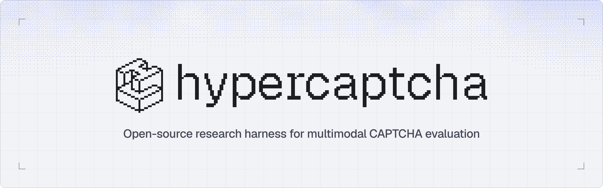
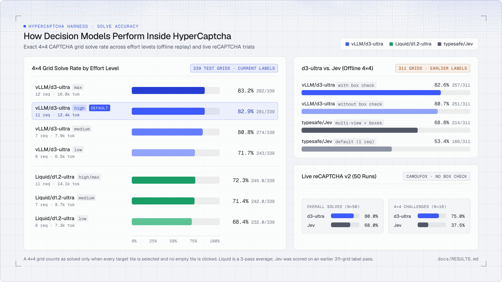
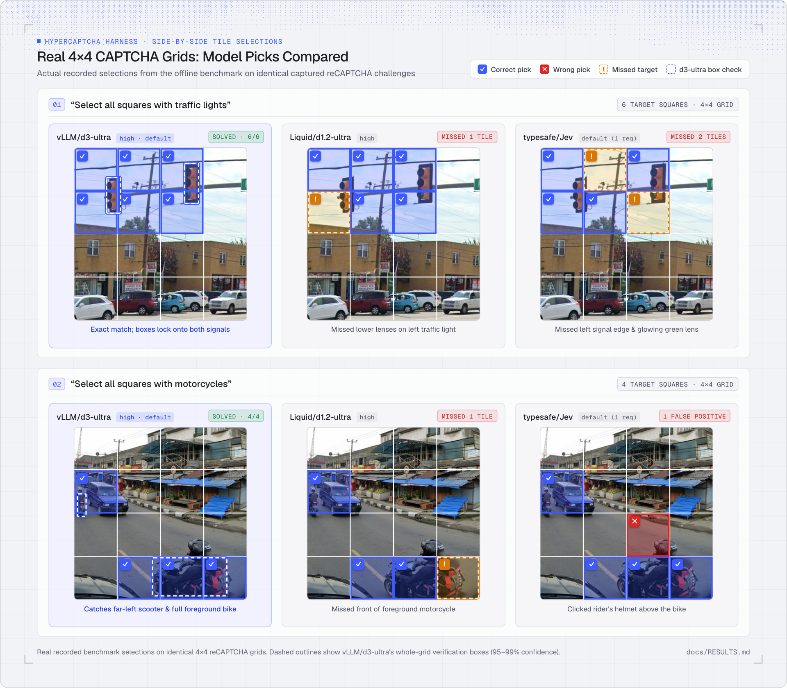

<p align="center">
  
</p>

# HyperCaptcha

**HyperCaptcha** is an open-source Rust and Python harness for solving and benchmarking **Google reCAPTCHA** and **hCaptcha** challenges with multimodal decision models, live in Camoufox or offline on saved grids with `hypercaptcha-eval`.

> **Research use only:** HyperCaptcha is built for research and should not be used on third-party sites without permission. See [SECURITY.md](SECURITY.md) · [Apache-2.0](LICENSE).

---

## How the Harness Makes Selections

Asking a vision model once on a raw screenshot leaves accuracy on the table: edge fragments get missed, background objects trigger false clicks, and small differences in image resizing shift borderline tiles. HyperCaptcha drives decision models with five concrete techniques:

- **Multi-view tile scoring (whole grid + close-ups):** Every square is scored on the full grid for scene context and again in zoomed close-up crops for fine details (such as distant wheel edges or signal housings). On 4×4 grids at `--effort high` and `max`, close-ups are run at two resolutions (capture size + `506 px`) and averaged in log-odds.
- **Neighbor-aware logistic scoring:** Instead of a naive 50/50 average, a fitted logistic rule combines each square's whole-grid score, close-up score, and strongest edge-adjacent neighbor scores, capturing continuity when a single object (like a bus or traffic light) spans adjacent 4×4 tiles.
- **Skip-grid presence gate:** On skippable 4×4 challenges (*"If there are none, click skip"*), a parallel presence query checks whether the target exists anywhere on the grid before selecting tiles.
- **Bounding-box verification (veto, not rescue):** At `--effort medium` and above, the harness asks the model to locate target instances with bounding boxes (up to 9 whole-grid boxes on `vLLM`, a single multi-instance query on `Liquid`, plus 16 zoomed per-tile windows at `max`). High-confidence picks (`≥ 95.3%` on `d3-ultra`) pass automatically; lower-confidence picks are dropped unless a confident box reaches into that square.
- **Early-tile inference & reproducible preprocessing:** On dynamic 3×3 grids, replacement tiles are composited and scored ahead of the widget's reveal timer as soon as they are fetched. Parallel crop batching, connection warming, hedged retries, and byte-exact Pillow/libjpeg encoding (`src/pillow.rs`) keep latency low and offline replays identical to live runs.

---

## How Models Perform in HyperCaptcha

On 4×4 image-grid CAPTCHAs (*"Select all squares with traffic lights"*), a grid counts as **solved** only when every target square is selected and no empty square is clicked.

HyperCaptcha lets you dial how much work the harness asks a model to do on each 4×4 grid via `--effort`:
- **`low`**: Whole grid + 1 close-up pass + skip check (`6` requests)
- **`medium`**: Adds whole-grid bounding-box verification to drop false positives (`7` requests)
- **`high`** *(default)*: Adds a 2nd close-up pass at capture resolution (`11` requests)
- **`max`**: Adds 16 zoomed per-tile window box checks (`12` requests)

<p align="center">
  
</p>

<p align="center">
  
</p>

### Side-by-Side Tile Selections on Real 4×4 Grids

<p align="center">
  
</p>

- **Why `--effort high` is the default:** Inside HyperCaptcha, `vLLM/d3-ultra` at `high` solves **`82.9%` (`281/339`)** of 4×4 test grids, within 1 grid of `max` (`83.2%`, `282/339`), while using **`4,404` fewer input tokens** and cutting median provider compute wait roughly in half (**`282 ms`** vs. **`556 ms`**).
- **Comparing decision models in the harness:** `Liquid/d1.2-ultra` peaks at **`72.3%`** (`high`/`max`), while `typesafe/Jev` reaches **`53.4%`** in its single-request default or **`68.8%`** with multi-view + box verification on an earlier 311-grid label pass (and **`68.0%`** vs. `d3-ultra`'s **`80.0%`** in a live 50-attempt reCAPTCHA v2 Enterprise run without box checks).
- **Offline vs. live scope:** The 4×4 box verification, `--effort` tiers, `Liquid/*`, and `hCaptcha` solve rates have been measured offline or on test keys, not yet on live production verdicts. Full methodology, dataset details, additional models (`Liquid/d1.2`), and caveats live in [docs/RESULTS.md](docs/RESULTS.md) and [docs/BENCHMARK_REPORT_2026-11-15.md](docs/BENCHMARK_REPORT_2026-11-15.md).

---

## Using HyperCaptcha

**Prerequisites:** **Rust 1.88+**, **Python 3.11+**, and **[uv](https://docs.astral.sh/uv/)** (or `pip`). Full installation and CAPTCHA key setup instructions live in [docs/SETUP.md](docs/SETUP.md).

### 1. Try It Locally Without API Keys

Inspect shipped models, validate TOML configs, and start a local smoke lab using official public test keys:

```sh
# List built-in models, required env vars, default decision rules, and effort tiers
cargo run --locked -- models

# Validate one or more model configs offline
cargo run --locked -- validate-config models/recaptcha/vllm/d3-ultra.toml

# Google reCAPTCHA v2 public test key (defaults to --mode v2 -> http://localhost:8765)
cargo run --locked -- serve --google-test-key

# hCaptcha public test key (defaults to --captcha hcaptcha -> http://hypercaptcha.localhost:8765)
cargo run --locked -- serve --hcaptcha-test-key
```

### 2. Solve CAPTCHAs Automatically in Camoufox

Copy `.env.example` to `.env`, add your localhost CAPTCHA key and model provider key (such as `VLLM_SR_API_KEY`, `LIQUID_API_KEY`, or `TYPESAFE_API_KEY`), and pass `--env-file .env` explicitly (shell env vars always take precedence):

```sh
cp .env.example .env

cargo run --release --locked -- serve \
  --env-file .env \
  --mode v2-enterprise \
  --model vLLM/d3-ultra \
  --log reports/vllm-server.jsonl
```

`--effort` defaults to `high` (`low`, `medium`, `high`, and `max` are all supported). In a second terminal, fetch the pinned Camoufox browser once and run automated trials:

```sh
uv run --extra browser python -m camoufox fetch
uv run --extra browser python scripts/recaptcha_lab.py --trials 5 --submit --output reports/vllm-live
uv run hypercaptcha-eval summarize reports/vllm-live/trials.jsonl
```

#### Browser Runner Quick Reference

Both runners use Camoufox (via `--extra browser`), read `GET /config` capability flags automatically, and work with `vllm`, `liquid`, `jev`, `custom` (`--model-config`), and `openai-chat`:

| Script | Default `--output` | Automated Flags | Special Modes |
| --- | --- | --- | --- |
| `scripts/recaptcha_lab.py` | `reports/recaptcha` | `--trials`, `--submit`, `--max-rounds`, `--max-stages`, `--no-early-tiles`, `--fast`, `--headed` | `--interactive`, `--smoke`, `--score` *(v3/v3-enterprise)* |
| `scripts/hcaptcha_lab.py` | `reports/hcaptcha` | `--trials`, `--submit`, `--max-rounds`, `--max-stages`, `--max-refreshes`, `--headed` | `--interactive`, `--smoke` |

### 3. Tune & Export Your Own Decision Model Offline

`hypercaptcha-eval` turns captured runs into a fitted, validated TOML config and deterministic parity fixture without touching live CAPTCHA services during tuning:

```sh
# 1. Deduplicate captured runs into a portable manifest
uv run hypercaptcha-eval dataset reports/capture-run -o datasets/4x4/dataset.jsonl --layout 4

# 2. Label grids in the local browser UI (127.0.0.1 only)
uv run hypercaptcha-eval label --dataset datasets/4x4/dataset.jsonl --labels datasets/4x4/labels.jsonl

# 3. Record raw two-view scores, skip probabilities, and boxes (auto-discovers target/release/hypercaptcha)
cargo build --release --locked
uv run hypercaptcha-eval record --dataset datasets/4x4/dataset.jsonl -o recordings/my-model.jsonl \
  --model-config models/examples/custom-decision-model.toml --passes 3

# 4. Fit logistic weights, sweep effort tiers, and export + validate TOML & parity fixture
uv run hypercaptcha-eval fit --dataset datasets/4x4/dataset.jsonl --labels datasets/4x4/labels.jsonl \
  --recordings recordings/my-model.jsonl --layout 4 -o recordings/fit.json
uv run hypercaptcha-eval sweep --dataset datasets/4x4/dataset.jsonl --labels datasets/4x4/labels.jsonl \
  --recordings recordings/my-model.jsonl --fit recordings/fit.json -o recordings/sweep.json
uv run hypercaptcha-eval export --base-config models/examples/custom-decision-model.toml \
  --sweep recordings/sweep.json --fit recordings/fit.json \
  -o my-model.toml --fixture tests/fixtures/my_model_4x4.json.gz --recordings recordings/my-model.jsonl
cargo run --locked -- validate-config my-model.toml
```

See [docs/ADDING_MODELS.md](docs/ADDING_MODELS.md) for the complete `schema_version = 1` TOML schema, capability flags, and custom-provider walkthrough.

---

## Developing HyperCaptcha

### Architecture & Repository Layout

Challenges flow from the local lab page or Camoufox runner (`scripts/`, `web/`) to the localhost Rust server (`src/server.rs`), which loads declarative `models/**/*.toml` `WireProfile` configs (`src/captcha/mod.rs`, `src/plan.rs`) and runs parallel multi-view + box-verification fan-out (`src/providers.rs`, `src/boxes.rs`). Byte-exact image preprocessing lives in `src/pillow.rs`, positional-image translation and patch-token billing guards live in `src/liquid.rs`, and hCaptcha canvas segmentation lives in `src/captcha/hcaptcha/grid.rs`.

```text
src/
  main.rs                 # CLI entry point (`serve`, `models`, `validate-config`)
  envfile.rs              # Opt-in `--env-file` parser & precedence overlay
  server.rs               # Localhost-only HTTP server, Host/Origin guards, JSONL logging
  providers.rs            # WireProfile-driven parallel fan-out, log-odds scoring, warming & hedging
  plan.rs                 # Owned/deserializable 4x4 effort plans, gap rule, box verification rule
  boxes.rs                # 9-ordinal, every-instance, and 16-window box requests + incremental Vote
  pillow.rs               # Byte-exact Pillow bilinear resizer & libjpeg baseline 4:2:0 q90 encoder
  liquid.rs               # Positional-image dialect rewriter & 1.5 tokens/patch billing guard
  captcha/                # Service profiles (recaptcha/, hcaptcha/ + canvas grid segmentation)
models/                   # Embedded schema_version=1 TOML configs + custom-decision-model.toml starter
eval/                     # Standalone Python toolkit (`hypercaptcha-eval`: dataset/label/record/fit/sweep/export/summarize)
scripts/                  # Camoufox browser runners (`recaptcha_lab.py`, `hcaptcha_lab.py`, `_common.py`)
web/                      # Embedded local lab UI (`recaptcha/`, `hcaptcha/`, `lab.css`)
tests/                    # Rust integration tests, Python eval tests, image-free `.json.gz` parity fixtures
docs/                     # Setup, empirical results, adding models, architecture, and historical report
```

### Local Verification Suite

All checks below run completely offline (no API keys or live browsers required) and match `.github/workflows/ci.yml`:

```sh
# Rust formatting, lints, unit/integration tests, and offline fixture parity
cargo fmt --check
cargo clippy --all-targets -- -D warnings
cargo test --locked
cargo run --locked -- models >/dev/null
cargo run --locked -- validate-config models/recaptcha/*/*.toml models/hcaptcha/*/*.toml models/examples/custom-decision-model.toml

# Python runner syntax/CLI checks and offline eval + Rust-parity tests (5,288/5,288 exact fixture checks)
uv run --extra browser python -m py_compile scripts/_common.py scripts/recaptcha_lab.py scripts/hcaptcha_lab.py
uv run --extra browser python scripts/recaptcha_lab.py --help >/dev/null
uv run --extra browser python scripts/hcaptcha_lab.py --help >/dev/null
uv run --extra dev pytest -v
```

### Common Extension Paths

- **Try an unmeasured model on an existing provider:** Run `hypercaptcha serve --provider vllm --model <model-id> --decision-rule average` (or `--record` to log raw views/boxes for offline fitting) without editing code.
- **Add a custom decision-model API:** Copy [models/examples/custom-decision-model.toml](models/examples/custom-decision-model.toml), configure `[endpoint]` (`systemone-assets` or `systemone-images` dialect), validate with `hypercaptcha validate-config`, and pass `--model-config <path.toml>` to `serve` or `hypercaptcha-eval record`.
- **Ship a built-in model & parity fixture:** Place its TOML under `models/<service>/<provider>/<model>.toml`, register it via `include_str!` in `src/captcha/<service>/mod.rs`, generate an image-free/label-free `.json.gz` fixture under `tests/fixtures/` via `hypercaptcha-eval export --fixture`, and verify both `cargo test --locked` and `uv run --extra dev pytest -v`.
- **Add a new wire dialect or CAPTCHA service:** Extend `WireDialect` / `WireProfile` in [src/providers.rs](src/providers.rs) and [src/captcha/mod.rs](src/captcha/mod.rs) (see [docs/ARCHITECTURE.md](docs/ARCHITECTURE.md) and [docs/ADDING_MODELS.md](docs/ADDING_MODELS.md#adding-a-new-wire-dialect-in-rust)).
- **Data hygiene:** Keep raw captures, labels, logs, and `.env` files in gitignored paths (`/reports/`, `/datasets/`, `/recordings/`); never commit CAPTCHA imagery, human labels, or credentials. See [CONTRIBUTING.md](CONTRIBUTING.md).

---

## Documentation

| Guide | What It Covers |
| --- | --- |
| [docs/SETUP.md](docs/SETUP.md) | Rust/Python/Camoufox installation, Google reCAPTCHA & hCaptcha key setup, `.env` / `--env-file`, localhost security |
| [docs/RESULTS.md](docs/RESULTS.md) | Full empirical report (datasets, effort ladders, `Liquid/d1.2`, negative findings, live runs, unmeasured scope) |
| [docs/ADDING_MODELS.md](docs/ADDING_MODELS.md) | Unmeasured models, custom `schema_version = 1` TOML configs, full `hypercaptcha-eval` loop, adding wire dialects |
| [docs/ARCHITECTURE.md](docs/ARCHITECTURE.md) | Server routes, JSONL schemas, decision & box-verification pipeline, `pillow.rs`, `liquid.rs`, hCaptcha segmentation |
| [docs/BENCHMARK_REPORT_2026-11-15.md](docs/BENCHMARK_REPORT_2026-11-15.md) | Historical November 15, 2026 live 50-attempt `Jev` vs. `d3-ultra` failure review |
| [CONTRIBUTING.md](CONTRIBUTING.md) · [SECURITY.md](SECURITY.md) · [LICENSE](LICENSE) | Development workflow, parity-fixture rules, responsible-research scope, Apache-2.0 license |
