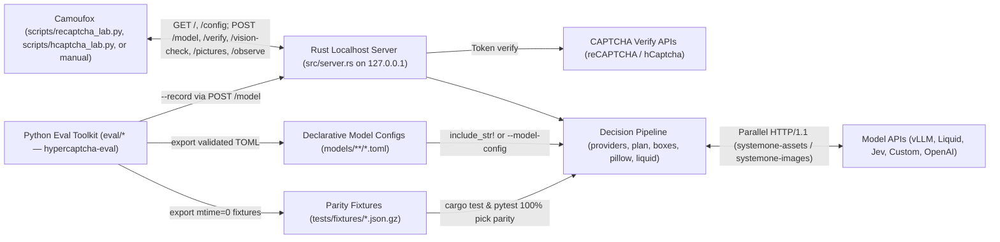
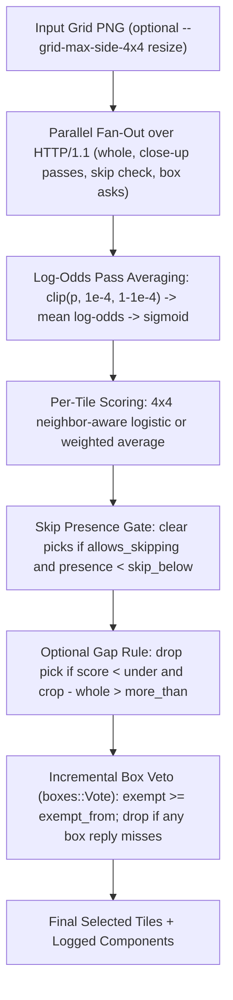

# Architecture

HyperCaptcha consists of two cleanly separated subsystems connected by a shared declarative TOML model contract (`schema_version = 1`) and image-free parity fixtures (`tests/fixtures/*.json.gz`):

1. **Rust Localhost Lab & Decision Engine (`src/`, `models/`, `web/`)** — serves local CAPTCHA test pages (`hypercaptcha serve`, with opt-in `--env-file`), inspects/validates configs offline (`hypercaptcha models`, `hypercaptcha validate-config`), verifies tokens with Google reCAPTCHA or hCaptcha, orchestrates parallel multi-view & box-veto requests, and logs structured JSONL records.
2. **Python Browser Runners (`scripts/`) & Offline Evaluation Toolkit (`eval/`)** — drives Camoufox trials (`scripts/recaptcha_lab.py`, `scripts/hcaptcha_lab.py`, shared `scripts/_common.py`) against the localhost server, builds deduplicated datasets, serves a local labeling UI, records raw model outputs, fits/sweeps rules, and exports validated TOML configs and parity fixtures.

---

## 1. Rust HTTP Server Routes & Security Model (`src/server.rs`)

The lab server binds strictly to `127.0.0.1:<port>` (`--port 0` picks an ephemeral port) using `tiny_http`. On startup, `stdout` line 1 is strictly `Open http://<host>:<port>` (parsed by `eval/record.py` and tests), while `stderr` receives a 1-line summary of the active service, mode, model, effort, and log path (zero secrets).

### Security & Input Boundaries

- **Strict `Host` header check:** Every request must carry `Host: <page_host>:<port>` (`localhost:<port>` or `--hostname <host>:<port>` for reCAPTCHA; `hypercaptcha.localhost:<port>` or `--hostname <host>:<port>` for hCaptcha). Any mismatch returns HTTP `403`, mitigating DNS rebinding.
- **Strict `Origin` header check on mutations:** Every `POST` request must carry `Origin: http://<page_host>:<port>`, blocking cross-origin requests to local API credentials.
- **Response headers & payload limits:** Every response sets `Cache-Control: no-store` and `X-Content-Type-Options: nosniff`. JSON request bodies are capped at `16 MiB`, base64 replacement tiles at `1 MiB`, `trial_id` to `1–64` ASCII alphanumeric/hyphen chars, `prompt` to `300` bytes, and input PNG dimensions to `280–1568` px per side (validated via PNG signature, IHDR dimensions, and `tiny_skia::Pixmap::decode_png`).

### HTTP Endpoints

| Method & Route | Purpose | Key Behavior |
| --- | --- | --- |
| `GET /`, `/lab.js`, `/lab.css` | Serve local lab UI | Serves embedded files from `web/recaptcha/`, `web/hcaptcha/`, and `web/lab.css`. |
| `GET /config` | Lab & model capability metadata | Returns CAPTCHA config (`mode`/`captcha`, `site_key`, `test`, `score_based`), provider/model identity (`provider`, `model`, `model_name`), active thresholds, `effort` (default `high`), `plan_4x4` (`close_ups` serialized as `[null, 506]`), `api_keys` count, and capability flags (`supports_vision`, `requires_vision_check`, `is_decision`). |
| `POST /verify` | Verify CAPTCHA token | Calls Google SiteVerify (`v2`/`v3`), Google Cloud reCAPTCHA Enterprise Assessments (`v2-enterprise`/`v3-enterprise`/`policy-challenge`), or `https://api.hcaptcha.com/siteverify`. Validates hostname (allowing hCaptcha's documented `"not-provided"` fallback) and expected action. |
| `POST /vision-check` | Verify image understanding | Sends synthetic red and blue control images through the active decision provider's dialect and image format; passes iff `P(red \| red) >= 0.7` and `P(red \| blue) <= 0.3`. Cached in a `OnceLock` for the process lifetime. |
| `POST /model` | Score a grid or telemetry trace | Handles v3 telemetry traces (`trace`) or v2/hCaptcha grids (`layout`, `prompt`, `image`). Optionally composites fetched reCAPTCHA replacement tiles (`tiles`) or segments hCaptcha canvas screenshots (`pictures`), runs `/vision-check` automatically for decision providers, executes the decision pipeline, and returns picks, probabilities, `vllm_components`/`jev_components`, `provider_meta`, `usage`, and (when drawn/composed) `grid_png` and `pictures`. |
| `POST /pictures` | hCaptcha grid detection | Runs `src/captcha/hcaptcha/grid.rs` without invoking any model; returns `status: "grid"` with `pictures` + `grid_png`, or `status: "no_grid"` for non-grid tasks so `hcaptcha_lab.py` can refresh past them. |
| `POST /observe` | Record trial observation | Logs manual or runner trial outcomes (`no_image_challenge`, `captured`, `model_solved`, `model_failed`, `human_solved`, `abandoned`) for live image challenges. |

### JSONL Event Schemas

Every `POST` endpoint appends a single JSON line to `--log <path>` (or `io::sink()` when omitted) under a unified envelope:

- **Common fields:** `trial_id`, `source` (`browser` | `camoufox` | `chrome`; both Camoufox runners send `camoufox`, while `chrome` remains accepted for compatibility), `event` (`google` | `hcaptcha` | `model` | `vision_check` | `pictures` | `observation`), `timestamp_ms`, optional `latency_ms`, service tags (`mode` + `google_test_key` for reCAPTCHA; `captcha: "hcaptcha"` + `hcaptcha_test_key` for hCaptcha), model metadata (`requested_model`, `model_name`, `provider`, `tile_threshold` on `model`/`vision_check` events), and event-specific `result`.
- **Log privacy invariant:** `grid_png` is attached to the HTTP response only **after** logging; screenshots, raw telemetry payloads, CAPTCHA tokens, and API keys are never written to server JSONL logs.
- **Camoufox browser runner logs (`scripts/recaptcha_lab.py`, `scripts/hcaptcha_lab.py`, shared `scripts/_common.py`):** Both runners write `trials.jsonl` (top-level `trial_id`, `outcome`, `rounds`, `browser` [`"camoufox"`], `browser_version`, optional `model_name`, optional `vision_check_id`, and `checkbox_to_verification_ms`) and `vision-checks.jsonl` under `--output`:
  - `scripts/recaptcha_lab.py` (default `--output reports/recaptcha`; also supports `--interactive`, `--smoke`, `--score`, `--headed`) records `mode`, optional `google`/`widget_message`, calls `POST /observe`, and writes per-round `prompt`, `layout` (`3` or `4`), `image`, `image_sha256`, `timeline_ms`, and optional `model`, `stage`, `rejection`, `judged`, `reloaded`, `early`, `early_not_used`, and `replaced_tile_ids`.
  - `scripts/hcaptcha_lab.py` (default `--output reports/hcaptcha`; also supports `--interactive`, `--smoke`, `--headed`) records `captcha: "hcaptcha"`, `passed_over` (refreshed non-grid tasks with `prompt`, `image`, `settled`, `ms`), optional `hcaptcha`/`checkbox_to_challenge_ms`/`stages`/`rejections`, does not call `POST /observe`, and writes per-round `prompt`, `layout` (`3`), `image` (`grid-NN.png` or `task-NN.png`), `page`, `pages`, `examples`, `settled`, `pictures`, `shown_ms`, and (when submitting) `model_ms`, `model`, `picks`, `label_before_submit`, `answered_ms`, and `result`.

---

## 2. Declarative Model Configs & `WireProfile` (`src/captcha/mod.rs`, `src/plan.rs`)

- **Service `Profile`:** Holds service-level invariants only (`layouts`, prompt parser, `allows_skipping`, tile photo question template, 3×3 average cutoff, and embedded built-in `Model` entries).
- **TOML Single Source of Truth (`models/`):** All 5 built-in models are stored as `schema_version = 1` TOML files under `models/` and embedded at compile time via `include_str!`. External configs loaded via `--model-config <path>` parse through the exact same `ModelConfig` deserializer and strict validator.
- **Decoupled `WireProfile`:** All HTTP and wire behavior in `src/providers.rs` and `src/liquid.rs` reads from `WireProfile` rather than branching on `Provider` enum variants:
  - `dialect` (`systemone-assets` vs. `systemone-images`)
  - `base_url`, `api_key_envs`, `extra_api_keys_env`, `extra_headers`
  - `image_format`, `crop_filter`, `gzip`, `max_images`, `multi_state_windows`, `supports_every_box`, `return_meta`, `hedge_on_stall`, `warm_connections`, `min_patch_tokens`
- **`Plan` (`src/plan.rs`):** Owned, deserializable struct describing a 4×4 round (`close_ups: Vec<Option<u32>>`, `select_from`, `skip_below`, `boxes: Option<BoxRule>`, `gap: Option<GapRule>`; `--effort` defaults to `high` across `low`/`medium`/`high`/`max`, and `--record` constructs `Plan::record(wire.supports_every_box)`). `close_ups` accepts `"capture"` (`None`) or a positive pixel length (`Some(px)`) in TOML and serializes as `[null, 506]` in `GET /config` JSON.

---

## 3. Multi-View Decision & Box-Veto Pipeline (`src/providers.rs`, `src/boxes.rs`)

For two-view decision providers (`vllm`, `liquid`, `custom`), a 4×4 round executes in six stages:

### Key Pipeline Mechanics

1. **Parallel fan-out & transport tuning:**
   - Every scoring request, skip presence request, and box request for a round launches simultaneously on separate threads over HTTP/1.1 (`pool_idle_timeout(None)`, `tcp_nodelay(true)`).
   - 4×4 close-up crops are grouped at `--close-ups-per-request` (default `4`, capped at `min(8, max(wire.max_images - 1, 1))`) with the full scene attached to each crop batch.
   - When `wire.warm_connections` is true (and `--cold-connections` is not set), the server pre-opens `2 + box_reqs + passes * batches` connections (`6`/`7`/`11`/`12` for `vLLM/d3-ultra` `low`/`medium`/`high`/`max`) using a `544×544` noise-JPEG warmup request, keeps them warm for `300 s`, and pings `GET /models` after `45 s` idle (`pool_max_idle_per_host` matches the same count).
   - When `wire.hedge_on_stall` is true (deterministic endpoints only), unanswered requests are hedged at `1.5 s`, `4.0 s`, and `8.0 s`, rotating round-robin across `extra_api_keys_env`. Transient `429`/`5xx` responses obey `Retry-After` (capped at `10 s`).
2. **Log-odds close-up pass averaging:** Multiple close-up passes (e.g., `capture` + `506` px) are combined in clipped log-odds space (`clip_prob(p) ∈ [1e-4, 1 - 1e-4]`) before scoring.
3. **Neighbor-aware logistic scoring:**
   - **3×3:** `sigmoid(w0 * lo(whole) + w1 * lo(crop) + b)`.
   - **4×4:** `sigmoid(w0 * lo(whole) + w1 * lo(crop) + w2 * max_nb4(lo(whole)) + w3 * max_nb4(lo(crop)) + b)`, where `max_nb4` is the maximum clipped log-odds among the 4 orthogonal edge neighbors (up, down, left, right).
4. **Skip presence gate:** On prompts offering skipping (`allows_skipping`), a dedicated parallel yes/no question asks whether at least one target object appears anywhere in the grid. If `presence < plan.skip_below`, all selections are cleared.
5. **Gap rule (`GapRule`):** Used on boxless tiers (such as `vLLM/d3-ultra` `low`): drops a selected square when `score < gap.under` and `close_up_prob - whole_prob > gap.more_than`.
6. **Incremental box veto (`boxes::Vote` in `src/boxes.rs`):**
   - Picks with `score >= rule.exempt_from` are exempt and never removed.
   - All remaining picks (`at_risk`) enter `boxes::Vote`, which listens on an `mpsc` channel for box replies as they arrive (`BoxAsk::Whole` [9 ordinal prompts], `BoxAsk::Every` [single `type="boxes"` multi-instance prompt], and/or `BoxAsk::Windows` [16 per-square neighborhood windows]).
   - A box with `confidence >= threshold` reaches tile `t` (whose unit-square rect is `[col/4, row/4, (col+1)/4, (row+1)/4]`) iff `shared_area * 16.0 >= rule.cover` and `shared_area / box_area >= rule.inside`.
   - Every configured box ask must reach an at-risk pick for it to survive; as soon as any complete reply fails to reach a pick, `Vote::hear` drops it immediately. Once `Vote::settled()` is true (no undecided picks remain), the round returns without waiting on slower remaining box replies (unless `--box-wait` or `--record` is enabled). If a box request fails, undecided picks remain selected (fail-safe) and the error is logged.

---

## 4. Byte-Exact Pillow & libjpeg Encoder (`src/pillow.rs`)

Box-rule measurements were collected using Python's Pillow (`Image.resize(..., Image.BILINEAR)` and `Image.save(..., "JPEG", quality=90)`), and `vLLM/d3-ultra`'s bounding boxes proved sensitive to subsampling and encoder differences (omitting `4:2:0` chroma subsampling or splitting window requests altered veto outcomes on `1–2` of `60` grids).

`src/pillow.rs` therefore implements Pillow's exact image pipeline directly in Rust:
- **Resampling:** Matches Pillow's `Resample.c` fixed-point bilinear filter (`22`-bit precision, center-aligned sampling, and Pillow's horizontal-vs-vertical pass ordering rule) with `round_ties_even` crop/target dimensions (`778` px whole-grid, `386` px per-square windows).
- **JPEG Encoding:** Implements libjpeg's baseline `4:2:0` quality-90 encoder (standard luma/chroma quantization tables at `jpeg_quality_scaling(90) = 20`, slow integer DCT, and standard Huffman tables).
- Verified byte-for-byte identical against Pillow across all `5,661` box pictures of `333` captured 4×4 grids.

---

## 5. Positional-Image Adapter & Patch-Token Guard (`src/liquid.rs`)

Endpoints using the `systemone-images` dialect (such as Liquid's Decisions API) differ from named-asset System One endpoints in three critical ways:

1. **Positional image references:** Named `assets` are ignored without returning an error (causing the API to answer from text alone at ~51 tokens). `src/liquid.rs` strips `assets`, discovers image references in deterministic first-mention order (`state`, then `questions`), encodes them into an ordered `images` array of `data:image/<fmt>;base64,...` URLs, and rewrites every reference to `"image N"` (under object keys) or `"PHOTO is image N."` (inside instruction lists).
2. **Per-request image & state caps:** Enforces `max_images` (e.g., `8` for Liquid) and pairs with `multi_state_windows = false` so 16 window box queries fan out as 16 single-state requests.
3. **Patch-token billing floor (`min_patch_tokens`):** Computes `ceil(1.5 * ceil(width / 32) * ceil(height / 32))` for each attached image and rejects any response whose billed input tokens fall below that sum — turning silent image-drop regressions into hard errors.

---

## 6. hCaptcha Canvas Grid Segmentation (`src/captcha/hcaptcha/grid.rs`)

hCaptcha draws all 9 pictures onto a single HTML `<canvas>` with slight per-tile nudging, tilt, and faint background noise, leaving no DOM elements per tile. `POST /pictures` and `POST /model` (for `--captcha hcaptcha`) locate the tiles purely from pixels:

1. **Panel color discovery:** Finds up to `4` distinct near-grey background candidates (`high - low <= 8`, `low >= 150`) plus edge colors (`PANEL_TOLERANCE = 12`, `EDGE_TOLERANCE = 6`) to classify flat panel pixels.
2. **Block localization:** Finds the longest contiguous stretch of columns and rows with `>= 15%` non-flat pixels (`PICTURE_SHARE = 0.15`), bridging narrow internal gaps (`5%` of width) and rejecting tiny noise runs (`< 4%`). Requires a near-square block (`aspect >= 0.80`) covering at least `45%` of the shorter screenshot side.
3. **Gutter validation (grid vs. non-grid discrimination):** Divides the block into thirds vertically and horizontally and searches narrow bands around the `1/3` and `2/3` lines. Accepts the screenshot as a 3×3 grid only if every gutter is at least `45%` flat panel (`GAP_SHARE = 0.45`) and the mean gutter flatness exceeds lines through tile centers by at least `0.20` (`GAP_OVER_MIDDLE = 0.20`) — rejecting single-image drag/point/motion challenges.
4. **Composition:** Crops the 9 places and arranges them edge-to-edge into a clean square PNG (`tile side` clamped to `64–256` px), returning the normalized bounding boxes (`pictures`) so `scripts/hcaptcha_lab.py` clicks the center of each selected tile on the original canvas.

---

## 7. Offline Evaluation Toolkit (`eval/`)

Packaged in `pyproject.toml` as `hypercaptcha-eval` (`requires-python >= 3.11`, base deps `numpy` + `httpx`, optional extras `browser` [`camoufox==0.5.9`] and `dev`) and invoked via `hypercaptcha-eval <subcommand>` or `python -m eval <subcommand>`:

| Module | Subcommand | Responsibility |
| --- | --- | --- |
| `eval/schema.py` | *(library)* | Exact NumPy implementation of Rust's `clip_prob`, `log_odds`, `sigmoid`, 4-neighbor max, box cover/inside geometry, and `decide_4x4`. Verified to reproduce `5,288/5,288` exact tile picks across all 3 committed `.json.gz` fixtures. |
| `eval/dataset.py` | `dataset` | Scans `recaptcha_lab.py` / `hcaptcha_lab.py` runs (accepting `--service` or `--captcha`), deduplicates grids by image SHA-256, and preserves `trial_id` as `group_id` for leak-free grouped CV. |
| `eval/label_server.py` + `eval/label_ui.html` | `label` | Zero-external-dependency `127.0.0.1` HTTP server and browser UI (`GET /api/items`, `GET /api/image/<id>`, `GET /api/labels`, `POST /api/labels`) with 3-state marking (`target`/`sliver`/`empty`), `unclear`, and `--repeat-check` inter-rater agreement metrics. |
| `eval/record.py` | `record` | Auto-discovers `target/release/hypercaptcha` and spawns `hypercaptcha serve ... --record` (or attaches to loopback `--server-url`), accepts `--service` or `--captcha`, runs multi-pass concurrent recording with retry/resume and concise progress updates on `stderr`, strips `grid_png`, and never auto-reads `.env*`. |
| `eval/fit.py` | `fit` | Standardized ridge logistic regression for 3×3 and 4×4 grids with deterministic grouped K-fold CV and single-view baselines. |
| `eval/sweep.py` | `sweep` | Vectorized NumPy sweep across close-up passes, cutoffs, skip gates, gap rules, and box asks (`whole_grid`, `every`, `windows`) with grouped CV, cross-pass stability/flip rates, plateau-center selection, and paired grouped bootstrap 95% CIs. |
| `eval/export.py` | `export` | Emits and `tomllib`-validates `schema_version = 1` TOML `ModelConfig` files (supporting `--base-config <path.toml>` inheritance and `--service`/`--captcha`) and deterministic (`mtime = 0`), image-free/label-free `.json.gz` parity fixtures. |
| `eval/summarize.py` | `summarize` | Aggregates live `trials.jsonl` runs into Markdown/JSON reports with Wilson 95% CIs, challenge-type splits, rejection counts, timeline medians/p90s, and token totals. |
